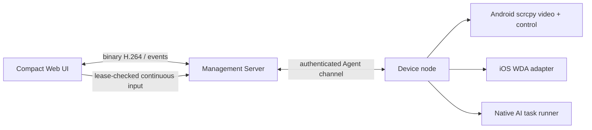

# DeviceDeck

Compact device management and responsive Android remote control, with native AI
Agent workflows. 一个统一的设备管理与远控工作台。

DeviceDeck 基于 [ai-phone](https://github.com/dongxinsuperman/ai-phone) 的 MIT 源码与
管理／任务能力开发，保留原作者署名和提交历史。它是独立下游项目，不是上游官方版本。
当前重点是 Android 手控体验；iOS 继续使用 WDA。

## MVP 能做什么

- 紧凑设备表格：搜索、别名、型号、节点、在线／就绪状态和当前占用。
- 浏览器内 Android 实时画面、连续按下／移动／抬起、键盘、导航键与画面恢复。
- 设备原始 H.264 → 二进制 WebSocket → WebCodecs；Android 新路径不做 FFmpeg 重编码或 MP4 分片。
- 自动选择设备编码器，避免强制使用 Google 软件编码器。
- 人工与 Agent 共用设备锁；每条实时输入检查当前锁，断线、释放、过期时清理未抬起的触控。
- 空闲设备可临时暂停／恢复镜像，已占用设备拒绝维护操作。
- 多节点设备发现、注册、心跳和重连；保留原生 Agent 任务、队列、历史、应用分发及模拟器管理。
- 保留 iOS WDA 适配与明确的未就绪提示；本次未完成新 Apple 签名。

## 实测对照

同一台 Android 10 真机、同一 USB/节点/前台 Chrome，440×960、30 FPS 上限、同一服务下发的码率配置，30 次重复点击：

| 测量边界 | 原 ai-phone compact | DeviceDeck |
|---|---:|---:|
| P50 | 833.3 ms | 70.3 ms |
| P95 | 1,039.4 ms | 95.6 ms |
| 成功观察到页面颜色变化 | 30 / 30 | 30 / 30 |

测量为 **浏览器合成 pointer-down → 手机测试页面响应 → 浏览器解码像素变化**，包含
40ms 模拟点击持有时间；不包含操作系统输入采样或显示器物理扫描。它不是互联网所有
环境的延迟承诺，也不是与原生 scrcpy 窗口的对比。新版另验证了按住时已经响应，而非松手后才提交滑动。

方法、原始样本和限制见 [MVP 验证](docs/validation/mvp-0001/README.md)。

## 架构与边界



**当前 MVP 的媒体仍经过中央 Server 转发**，不是 WebRTC/P2P。跨地域浏览器直连节点、
区域中继、完整多租户权限、鸿蒙实机验证属于后续工作。实际显示 FPS、解码队列与
端到端延迟是不同指标；静态屏幕也不会一直产出满帧率。

## 开始使用

需要 Python 3.11、Node.js 22+、PostgreSQL、ADB，以及已授权的 Android 设备。
物理设备不要求 root。模拟器须由宿主提供硬件加速；iOS 真机另外需要 macOS、完整
Xcode、签名与设备授权。

完整步骤见 [部署与配置](docs/deployment.md)。原有 Python 包和环境变量保持 `ai_phone`
与 `AI_PHONE_*` 名称以兼容已有节点；前端和产品版本从 DeviceDeck 0.1.0 开始。

```sh
cd backend
python3.11 -m venv .venv
.venv/bin/pip install -e '.[dev]'
# 按部署文档准备私有 .env、数据库和浏览器登录配置
```

```sh
cd web
npm ci
VITE_GATEWAY_AUTH=true npm run build
```

```sh
cd backend
.venv/bin/uvicorn --factory ai_phone.server.webapp:build_webapp --host 127.0.0.1 --port 8000
```

浏览器登录密码与 Agent 连接令牌分别配置；前端不嵌入服务令牌。生产入口使用 HTTPS，
因为浏览器 WebCodecs 需要安全上下文。

## 开发与验证

```sh
cd web
node --test tests/*.test.mjs
npm run build
```

```sh
cd backend
python -m pytest -q
```

设备集成测试与延迟工具应显式选定测试设备并持有它的锁。`tools/latency_target.py`
是临时 LAN 测试页面，不随服务默认启动；测量结束后停止。

- [产品需求](docs/prd/PRD-001-unified-device-platform/README.md)
- [MVP 迭代](docs/iterations/0001-mvp/README.md)
- [原上游 README](README.upstream.md)（用于兼容参考，原功能描述不代表全部已在本项目实机验收）

## 来源与许可

项目代码沿用 MIT，保留 Dongxin 和 ai-phone contributors 的版权声明；新增代码同样
采用 MIT。scrcpy、WebDriverAgent 等组件各自的许可与来源见
[Third-Party Notices](THIRD_PARTY_NOTICES.md)。Android 的 packet/WebCodecs 实现使用
现有 MIT scrcpy client 扩展，没有引入或复制 Webscreen 的 AGPL 代码。
