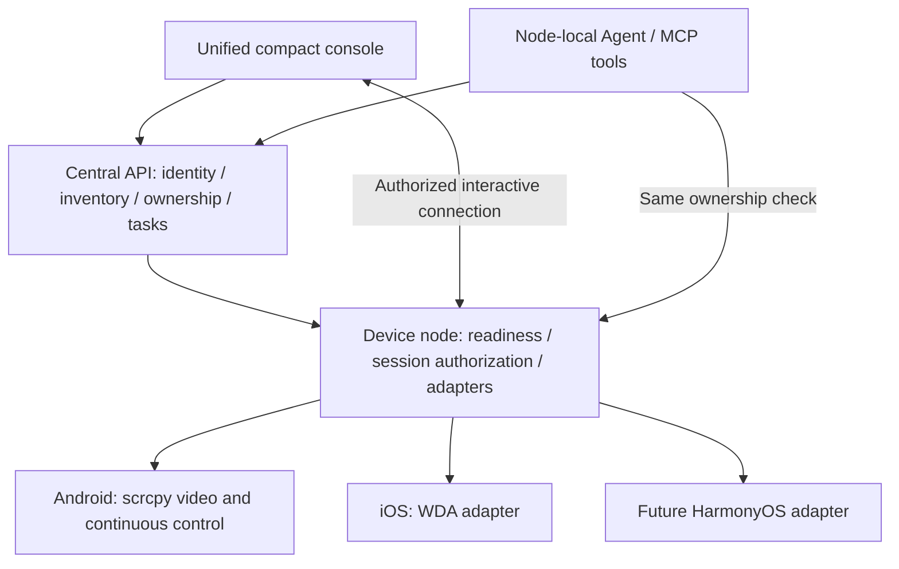

# PRD-001 — Unified device platform

Document version: 0.2, 2026-11-17. Status: MVP implementation authorized and delivered for review; user acceptance pending. This document does not change the running deployment or claim user acceptance of an implementation.

## Background and goal

The operator requires both responsive Android remote control and device management. Existing ai-phone has useful registration, readiness and leases, but its manual gesture handling waits until pointer release and its Android video pipeline adds re-encoding and fragmented-MP4/MSE playback. The previous compact iteration did not replace these paths.

The operator proposed integrating multiple projects into one platform owned and maintained by the operator. The intended product is one compact console, one device inventory and one ownership model; component boundaries should not require users to navigate separate management applications.

## Source and confirmation boundary

Confirmed in the conversation:

- Android interaction latency is the immediate problem; iOS WDA remains the chosen approach.
- Device management remains required; parts can be developed later.
- Earlier requirements include registration, maintenance, acquisition/release, geographically distributed nodes, physical devices and Android emulators, and future AI Agent operations.
- The UI should be compact. HK can serve as the central entrance and local machines as nodes.

Proposed here, not yet accepted as implementation choices:

- Trial Webscreen as an Android media/input engine; use ya-webadb components as an alternative if owning the browser decoder/control implementation is preferable.
- Reuse or extract working ai-phone management logic and the existing Vue/FastAPI/PostgreSQL stack before considering a rewrite.
- Keep one management application/API and separate platform adapters. Avoid merging entire upstream applications or adopting all their databases and account systems.
- Keep management APIs central while placing interactive media/input endpoints beside devices. Region selection and routing need validation; neither WebRTC nor a public hostname guarantees a direct path.

## MVP implementation decisions

The operator authorized iteration 0001 on 2026-11-17. The implemented Android
engine extends the existing MIT scrcpy client with packetized H.264/WebCodecs
and continuous input; Webscreen was an architectural reference, not an imported
dependency. The current management and native Agent base is retained from
ai-phone. Media still relays centrally; per-region direct routing remains a
proposal. See the iteration and validation records for evidence and limits.

## User flows

1. An administrator registers a node; attached devices appear once with stable identity, location, readiness and maintenance state.
2. A user selects a free, ready device and acquires it. The same console opens an interactive session at its device node.
3. Pointer down/move/up reach Android as a continuous gesture. The user sees responsive video without first waiting to finish the gesture.
4. The user releases the device. Control authority is revoked at the node, including an already-open interactive channel.
5. An Agent acquires the same kind of ownership through the management API, runs device tools locally, records results and releases it. Manual takeover follows an explicit shared policy.
6. A disconnected or unhealthy node becomes unavailable; reconnect cannot revive a stale user's authority or create duplicate device records.

## Functional requirements

| ID | Requirement | Priority / status |
|---|---|---|
| F01 | One compact console with searchable device table and integrated workbench; show platform, node/location, readiness, owner and maintenance state | Core; recorded |
| F02 | Responsive Android screen delivery and continuous pointer down/move/up, with coordinate/rotation handling and cleanup on disconnect | Immediate focus; recorded |
| F03 | One authoritative acquisition/release mechanism for humans, Agents and background tasks | Core; recorded |
| F04 | Node enrollment, stable device identity, heartbeat/offline detection and safe reconnect | Core; recorded |
| F05 | Keep iOS WDA behind an iOS adapter; do not require changing the iOS approach to improve Android | Core; recorded |
| F06 | Node-local Agent tools, task state, cancellation and evidence, subject to the same ownership policy as the UI | Later implementation; recorded |
| F07 | Maintenance controls: mark unavailable, diagnose, reconnect and explicitly restart the relevant device service | Later implementation; recorded |
| F08 | Display honest stream diagnostics: actual displayed FPS, queue/buffer, first-frame time and measured interaction latency when available | Core; recorded |
| F09 | Future HarmonyOS/HDC adapter must not require redesigning inventory or ownership | Future extension; feasibility unverified |

## Proposed architecture

HK's proposed role is the central API/entrance; local nodes own device access. Direct or same-region interactive routes should be preferred where possible, with a documented fallback. Video need not pass through the central API merely because sign-in does.

The management application should issue a short-lived device/session-scoped grant only after acquiring ownership. The node validates it when opening a media/control session and maintains revocation state for that active session. Expiry, release, takeover or node reconnect must invalidate stale control; validating a token only once at connection time is insufficient.

The adapter contract needs discovery/readiness, opening/closing a session, video capability negotiation, continuous input, diagnostic health and explicit maintenance operations. Underlying engine accounts and raw ADB/WDA ports are not the product's user-facing authentication model.

## Integration boundaries and reuse

- **Management:** retain proven state transitions and migration paths from the existing fork. A rewrite is a choice to justify, not a prerequisite for a new product identity.
- **Android:** evaluate Webscreen's RTP/scrcpy-control path first. If selected, integrate session lifecycle and node authorization; simply placing an unrestricted engine page in an iframe does not implement F03.
- **Alternative browser components:** ya-webadb provides building blocks, not a ready-made remote resource pool. Remote transport, node authorization and lease enforcement remain integration work.
- **Agent:** an API/MCP adapter consumes the same session authority. Do not let its direct device calls bypass a user's active lease.
- **Presentation:** one frontend owns navigation, identity and device state. Mature media/control code may remain an independently supervised engine process.
- **Licenses:** Webscreen is AGPL-3.0; ya-webadb is MIT. Preserve upstream licenses and attribution and evaluate the selected integration's obligations before redistribution. Process separation is not itself a licensing conclusion. Enkaku's own-code license was not established in the research and it is not a selected dependency.

## Business rules and scope boundaries

- One controlling owner per device; multiple viewers, if supported later, do not receive input authority automatically.
- Backend and node enforce ownership; disabling frontend buttons is insufficient.
- A missing readiness prerequisite is not a ready device, even when USB discovery succeeds.
- Releasing ownership must stop synthetic held keys/touches and reject stale input.
- Never run two competing controllers during comparison or adopt a second engine by bypassing ownership.
- Registration, credentials and current inventory must remain recoverable through a staged migration.
- The operator subsequently authorized MVP development, deployment validation and creation/publication of an independent GitHub repository. This does not authorize unrelated features or unsupported performance claims.

## Acceptance and traceability

| ID | Covers | Acceptance |
|---|---|---|
| AC01 | F02, F08 | Compare native scrcpy, current ai-phone and the candidate sequentially on the same physical Android device with equivalent resolution/FPS/bitrate; record at least 30 click/drag samples, P50/P95 visible response, first frame, stalls and node CPU. Test the Jack emulator separately. Network RTT is not visible-response latency. |
| AC02 | F02 | During a held drag, the remote application reacts before pointer release; rotation, pointer cancellation and channel loss leave no stuck touches. |
| AC03 | F03, F06 | Concurrent human/Agent claims yield one owner. Release/takeover invalidates input through existing as well as new node connections. |
| AC04 | F01, F04 | Devices from two nodes appear in the same inventory; node loss updates state, reconnect preserves device identity and rejects stale session grants. |
| AC05 | F01 | Search, acquisition, control, release and basic diagnostics work from the same console without opening a separate engine dashboard. |
| AC06 | F05 | The iOS adapter retains its WDA lifecycle and readiness semantics; lack of signing is surfaced without disturbing Android sessions. |
| AC07 | F07 | Maintenance actions identify their device/service and require explicit operator intent; unrelated nodes and workloads remain running. |

A provisional LAN P95 target of 200ms can be used for the first comparison, subject to the actual device baseline. It is a proposal, not an upstream performance claim or a user-approved SLA. WAN results must include the selected ICE/direct/relay path and test location.

## Proposed delivery order

1. **Engine comparison:** measure Android video and continuous input. This is the gate before committing to a replacement engine or major rewrite.
2. **Vertical slice:** one device table, claim, authorized node session, responsive control and release. Keep a rollback to the current fork.
3. **Management expansion:** second node, maintenance, diagnostics and reconnect recovery.
4. **Agent integration:** API/MCP task execution and explicit human takeover under the same ownership model.

Iteration 0001 was explicitly authorized on 2026-11-17. See its validation record for implemented scope, live evidence and deferred work. Native scrcpy window timing and WAN benchmarks remain deferred; the immediate baseline gate used the existing ai-phone and the same physical phone.

## Open decisions

- Android engine selection after measurement; Webscreen integration versus custom client based on ya-webadb.
- Reuse boundaries within the current fork versus a new product repository, and product name.
- Central/node connection topology, relay fallback and actual WAN performance.
- Authentication/roles, artifact retention and the exact manual/Agent takeover policy.
- HarmonyOS hardware, supported HDC control/capture capabilities and corresponding acceptance.

## References

- [Current compact downstream implementation](../../downstream/compact-workbench.md)
- [Webscreen](https://github.com/huonwe/webscreen)
- [ya-webadb](https://github.com/yume-chan/ya-webadb)
- [YARD](https://github.com/Dinip/yard)

## Document changes

- 2026-11-17: initial requirements record and proposed component architecture, following the operator's Android latency clarification and unified-platform proposal.
